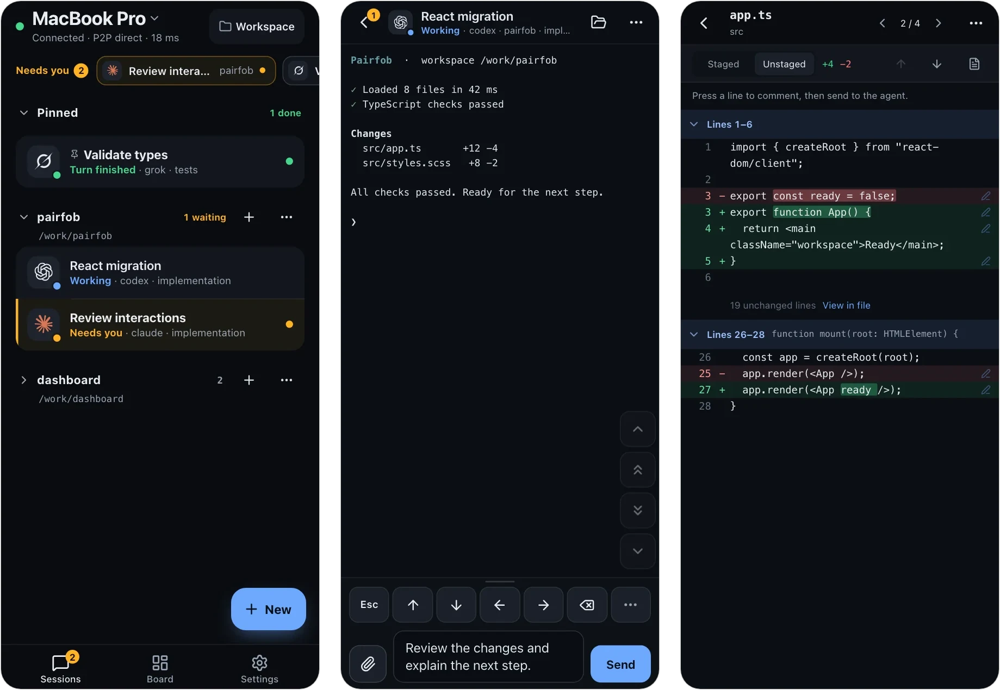

# Pairfob

[](LICENSE)
[](https://pairfob.com)
[](https://pairfob.com/doc/)

**English** | [简体中文](README_zh.md)

**Control the coding agents on your computer from your phone.** Codex, Claude,
Grok and the rest keep running on the computer; after pairing once, a phone,
tablet or another computer opens the same live sessions, not copies. The
computer only dials out — no inbound ports, no VPN — and the session is
end-to-end encrypted.



## Install and pair

Pairfob runs on macOS and Linux; Windows is not supported. The phone only needs
a browser, and no Pairfob account is required. Keep the computer awake and
online while you use it.

1. **Install on the computer.** The script installs Pairfob, adds the latest
   stable Herdr if it is missing, and sets Pairfob to start at login.

   ```sh
   curl -fsSL https://pairfob.com/install.sh | sh
   ```

   If it says the install directory is not on your `PATH`, run the one-line fix
   it prints. Flags, install locations and uninstall:
   [Install](https://pairfob.com/doc/install).

2. **Pair the phone.** On the computer, run `pairfob pair`. It shows a QR code
   and a code you can type instead.

   ```sh
   pairfob pair
   ```

   On the phone, open [pairfob.com/pair](https://pairfob.com/pair), scan the QR
   code (or type the code), then press Enter once on the computer.

3. **Open a session.** Tap a session in the phone's list to attach to it. To
   start one, choose **Create**, enter the project's absolute path on the
   computer, and pick an agent or **Terminal**.

Sessions come from [Herdr](https://herdr.dev): those started from the phone or
inside `herdr` appear in the list, while an agent started in another terminal
does not appear. Pairfob does not install or sign in to AI agents — do that on
the computer first; **Terminal** works without one. Full walkthrough:
[Get started](https://pairfob.com/doc/start).

Already living in Herdr? `herdr plugin install arronKler/pairfob` adds **Pairfob:
Pair a device** to Herdr's action menu and installs the same verified binary on
first use. See [`plugin/herdr/`](plugin/herdr/README.md).

Versioned macOS and Linux binaries, SHA-256 checksums and release notes are on
[GitHub Releases](https://github.com/arronKler/pairfob/releases).

## What you can do

- **Respond when an agent needs you.** A **Needs you** strip and optional push
  notifications show waiting agents; open one to answer its prompt.
- **Work in the live session.** **Auto** picks **Control** (terminal view,
  system keyboard, keypad), **Terminal** (the real PTY, for vim and full-screen
  TUIs) or **Chat** (message the agent and read its replies).
- **Review and hand over files.** Browse files, read git status and diffs,
  comment on diff lines, and upload photos, PDFs or other files into the draft.
- **Shape the workspace.** Start conversations, tabs, splits and worktrees, and
  see a tab's real pane layout on the **Board**.
- **Use several computers and devices.** One phone switches between computers;
  each computer can have several paired devices.
- **Track quota.** Subscription allowance for Codex, Claude Code, Copilot,
  Cursor, Grok and more, collected on the computer.

The app speaks English and 中文. Details: [Using the app](https://pairfob.com/doc/app).

## Android beta (optional)

The phone works in a browser. For an installed app, the optional Android beta is
a sideloaded APK for Android 7.0 and newer — it is not on the Play Store.
Install steps, updates, signing checksum and current limits:
[Android beta](https://pairfob.com/doc/android-beta). Downloads:
[GitHub Releases](https://github.com/arronKler/pairfob/releases).

## Security

- **Pairing** uses SPAKE2+ with a code both sides confirm; session keys are
  hardened with Argon2id.
- **Keys** live only on the computer and paired devices. The relay at
  `pairfob.com` forwards ciphertext frames it cannot read.
- **Direct when possible.** An established session upgrades to a WebRTC
  DataChannel and keeps the relay as fallback.
- **Nothing exposed.** The computer only dials out; Herdr is never reachable
  from the internet.

See [What the relay cannot see](https://pairfob.com/doc/security) and report
vulnerabilities privately via [SECURITY.md](SECURITY.md).

## Computer commands

```sh
pairfob          # status: service, paired devices, Herdr
pairfob pair     # pair a phone, tablet or another computer
pairfob list     # paired devices
pairfob forget 1 # unpair by index or name
pairfob doctor   # diagnose this computer; changes nothing
pairfob update   # update to the latest release and restart
```

A second computer runs the same installer, then pairs from the phone with
**Settings → Switch computer → Add a computer**. Machines that Herdr already
reaches over SSH can be added from the phone's **Computers** page without a
pairing code. Full CLI, service, setup and quota commands:
[Computer commands](https://pairfob.com/doc/cli).

## How it works

```
phone  --HTTPS/WSS pairfob.v2-->  pairfob.com (Worker + Durable Object)
pairfob --outbound WSS---------->  same room  --opaque FWD-->  phone
          \-- WebRTC DataChannel after authenticated setup --/
pairfob --loopback-------------->  Herdr
```

Sessions run in [Herdr](https://herdr.dev); the installer sets it up for you.

The phone reads the rendered pane and sends keys back to the PTY; it is not a
terminal emulator of its own. `pairfob.com` is the project's official instance.
Protocol specs live in [`proto/`](proto/), including
[direct transport](proto/direct-transport.md).

| Path | What it is |
| --- | --- |
| `cmd/pairfob` | the computer daemon and CLI |
| `internal/` | pairing, sessions, RPC, Herdr adapter, protocol primitives |
| `pwa/` | the phone app (React + TypeScript, built with bun) |
| `workers/pairfob-origin` | the relay: Cloudflare Worker + Durable Object |
| `site/` | homepage and [documentation](https://pairfob.com/doc/) sources |
| `proto/` | frozen envelope, RPC schema and test vectors |
| `plugin/herdr` | Herdr plugin entrypoints |

## Develop

```sh
(cd pwa && bun install --frozen-lockfile)
./scripts/dev-up.sh     # local origin + pairfob + PWA on loopback
./scripts/verify.sh     # full gate: Go, PWA, Worker, site tests and builds
./scripts/dev-down.sh
```

Set `PAIRFOB_DEV_FAKE_RUNTIME=1` for demo data without Herdr. Real-phone
testing, verification scope, protocol invariants and releases:
[`docs/develop.md`](docs/develop.md).

## Contributing

Issues and pull requests are welcome at
[github.com/arronKler/pairfob](https://github.com/arronKler/pairfob). Run the
checks that match your change (see
[`docs/develop.md`](docs/develop.md#verification)) and list them in the PR. The
envelope, vectors and RPC fields under `proto/` are frozen by design; please
open an issue before proposing a change there.

## Star History

<a href="https://www.star-history.com/?repos=arronkler%2Fpairfob&type=date&legend=top-left">
 <picture>
   <source media="(prefers-color-scheme: dark)" srcset="https://api.star-history.com/chart?repos=arronkler/pairfob&type=date&theme=dark&legend=top-left" />
   <source media="(prefers-color-scheme: light)" srcset="https://api.star-history.com/chart?repos=arronkler/pairfob&type=date&legend=top-left" />
   
 </picture>
</a>

## License

[Apache License 2.0](LICENSE). See [NOTICE](NOTICE).
