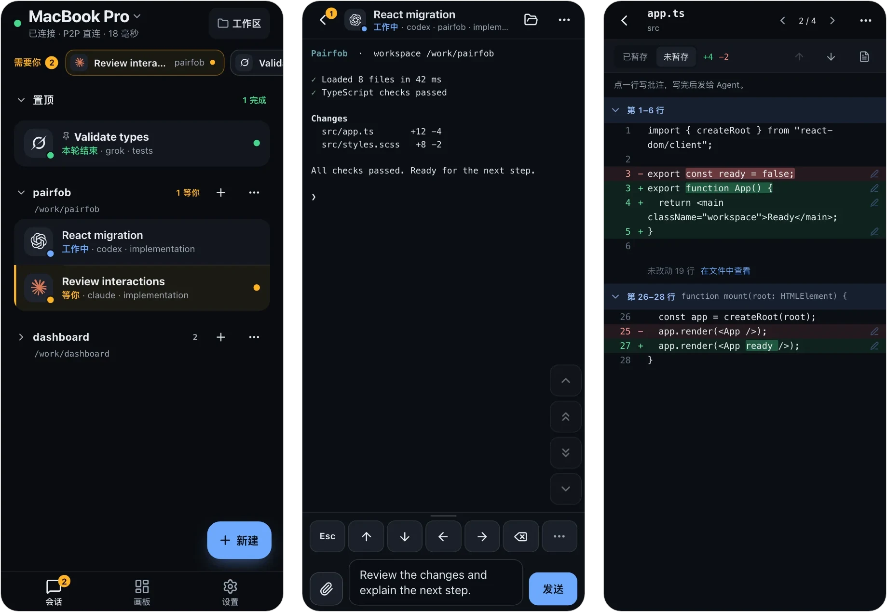

# Pairfob

[](LICENSE)
[](https://pairfob.com)
[](https://pairfob.com/doc/zh/)

[English](README.md) | **简体中文**

**在手机上操控电脑里的编程 Agent。** Codex、Claude、Grok 等继续在电脑上跑；配对
一次后，手机、平板或另一台电脑打开的是同一批活着的会话，不是副本。电脑只往外连
——不开入站端口、不需要 VPN——会话端到端加密。



## 安装与配对

Pairfob 运行在 macOS 和 Linux 上，不支持 Windows。手机只用浏览器即可，无需
Pairfob 账号。用手机接着操作时，电脑要保持唤醒并联网。

1. **在电脑上安装。** 安装脚本会装好 Pairfob，缺少 Herdr 时补装最新稳定版，
   并把 Pairfob 设为登录后自动启动的服务。

   ```sh
   curl -fsSL https://pairfob.com/install.sh | sh
   ```

   如果提示安装目录不在 `PATH` 上，按它打印的一行命令补上即可。安装参数、安装位置
   和卸载见[安装](https://pairfob.com/doc/zh/install)。

2. **配对手机。** 在电脑终端运行 `pairfob pair`，它会显示二维码，以及一串可以
   手输的配对码。

   ```sh
   pairfob pair
   ```

   在手机上打开 [pairfob.com/pair](https://pairfob.com/pair)，扫码（或手输
   配对码），然后在电脑上按一次回车。

3. **打开会话。** 在手机列表里点一个会话，打开的就是电脑上那个会话。要新建就点
   **创建**，输入电脑上项目的绝对路径，再选择 Agent 或 **终端**。

会话来自 [Herdr](https://herdr.dev)：只有从手机或 `herdr` 里启动的会话会出现在
列表里，直接在别的终端启动的 Agent 不会出现。Pairfob 不负责安装或登录 AI
Agent，请先在电脑上装好并登录；**终端**不需要 Agent 也能用。完整步骤见
[开始使用](https://pairfob.com/doc/zh/start)。

平时就在 Herdr 里？`herdr plugin install arronKler/pairfob` 会把
**Pairfob: Pair a device** 加进 Herdr 的动作菜单，首次使用时安装同一个经过
校验的二进制。见 [`plugin/herdr/`](plugin/herdr/README.md)。

各版本的 macOS、Linux 二进制、SHA-256 校验文件和更新说明见
[GitHub Releases](https://github.com/arronKler/pairfob/releases)。

## 在手机上能做什么

- **Agent 等你时及时处理。** 列表顶部的 **需要你** 和可选的推送通知会列出等待
  中的 Agent，点开即可处理提示。
- **在活着的会话里干活。** **自动** 会按会话选择 **控制**（终端画面 + 系统
  键盘 + 快捷键区，支持听写）、**终端**（真实 PTY，适合 vim 和全屏 TUI）或
  **对话**（给 Agent 发消息、看回复）。
- **审查改动、传递文件。** 浏览文件，查看 git 状态和 diff，在 diff 行上写评论，
  也可以上传照片、PDF 等文件并把工作区路径插入草稿。
- **管理工作区。** 新建对话、标签页、分屏和 worktree，在 **画板** 上看标签页的
  真实分栏。
- **多台电脑、多台设备。** 一台手机可以在几台电脑之间切换，一台电脑也可以配对
  多台设备。
- **看订阅余量。** 由电脑收集 Codex、Claude Code、Copilot、Cursor、Grok 等账号
  的额度。

界面支持中文和 English。详见[界面怎么用](https://pairfob.com/doc/zh/app)。

## Android 测试版（可选）

手机用浏览器就能用。想安装成应用，可以试试可选的 Android 测试版：侧载 APK，
支持 Android 7.0 及以上，尚未上架应用商店。安装步骤、更新、签名校验和当前限制见
[Android 测试版](https://pairfob.com/doc/zh/android-beta)；下载见
[GitHub Releases](https://github.com/arronKler/pairfob/releases)。

## 安全

- **配对** 用 SPAKE2+，配对码由双方确认；会话密钥用 Argon2id 加固。
- **密钥** 只在电脑和已配对设备上。`pairfob.com` 上的中继只转发它读不懂的密文帧。
- **能直连就直连。** 会话建立后升级为 WebRTC DataChannel，中继保留为兜底。
- **不暴露任何东西。** 电脑只往外连，Herdr 永远不会暴露到公网。

见 [中继看不到什么](https://pairfob.com/doc/zh/security)。安全漏洞请按
[SECURITY.md](SECURITY.md) 私下报告。

## 电脑上的命令

```sh
pairfob          # 状态：服务、已配对设备、Herdr
pairfob pair     # 配对手机、平板或另一台电脑
pairfob list     # 已配对设备
pairfob forget 1 # 按序号或名字解除配对
pairfob doctor   # 检查这台电脑；不做任何修改
pairfob update   # 更新到最新版本并重启服务
```

第二台电脑运行同一个安装脚本，然后在手机上用 **设置 → 切换电脑 → 添加电脑**
配对。Herdr 已经通过 SSH 连接的机器，可以在手机的 **电脑** 页里直接添加，不用
配对码。`pairfob setup`、`pairfob service …`、`pairfob quota …` 等完整命令见
[电脑上的命令](https://pairfob.com/doc/zh/cli)。

## 工作原理

```
phone  --HTTPS/WSS pairfob.v2-->  pairfob.com (Worker + Durable Object)
pairfob --outbound WSS---------->  same room  --opaque FWD-->  phone
          \-- WebRTC DataChannel after authenticated setup --/
pairfob --loopback-------------->  Herdr
```

会话在 [Herdr](https://herdr.dev) 里运行；安装脚本会帮你装好。

手机读取渲染好的终端画面，把按键发回 PTY；它本身不是终端模拟器。
`pairfob.com` 是本项目的官方实例。协议规格在 [`proto/`](proto/)，包括
[直连传输](proto/direct-transport.md)。

| 目录 | 内容 |
| --- | --- |
| `cmd/pairfob` | 电脑端 daemon 和命令行 |
| `internal/` | 配对、会话、RPC、Herdr 适配、协议原语 |
| `pwa/` | 手机端应用（React + TypeScript，用 bun 构建） |
| `workers/pairfob-origin` | 中继：Cloudflare Worker + Durable Object |
| `site/` | 主页和[文档](https://pairfob.com/doc/zh/)源码 |
| `proto/` | 冻结的信封格式、RPC schema 和测试向量 |
| `plugin/herdr` | Herdr 插件入口 |

## 开发

```sh
(cd pwa && bun install --frozen-lockfile)
./scripts/dev-up.sh     # 在本机回环地址启动 origin + pairfob + PWA
./scripts/verify.sh     # 完整检查：Go、PWA、Worker、站点测试和构建
./scripts/dev-down.sh
```

设置 `PAIRFOB_DEV_FAKE_RUNTIME=1` 可以不接 Herdr、用演示数据。真机调试、
验证范围、协议约束和发布流程见 [`docs/develop.md`](docs/develop.md)（英文）。

## 参与贡献

欢迎在 [github.com/arronKler/pairfob](https://github.com/arronKler/pairfob)
提 issue 和 PR。按改动范围运行对应检查（见
[`docs/develop.md`](docs/develop.md#verification)），并在 PR 里写明跑了哪些。
`proto/` 下的信封格式、测试向量和 RPC 字段是有意冻结的，想改动请先开 issue
讨论。

## Star 历史

<a href="https://www.star-history.com/?repos=arronkler%2Fpairfob&type=date&legend=top-left">
 <picture>
   <source media="(prefers-color-scheme: dark)" srcset="https://api.star-history.com/chart?repos=arronkler/pairfob&type=date&theme=dark&legend=top-left" />
   <source media="(prefers-color-scheme: light)" srcset="https://api.star-history.com/chart?repos=arronkler/pairfob&type=date&legend=top-left" />
   
 </picture>
</a>

## 许可证

[Apache License 2.0](LICENSE)。见 [NOTICE](NOTICE)。
